# Server Power Analysis Dashboard

> Comprehensive UPS power consumption analysis and monitoring for Server A and Server B

**Last Updated:** July 2, 2026  
**Analysis Period:** October 7, 2025 - July 2, 2026  
**Total Data Points:** 12,685 hourly readings

---

## 📊 Quick Summary

| Metric | Server A | Server B | Difference |
|--------|----------|----------|------------|
| **Average Load** | 307.3 W | 451.8 W | -144.5 W ⬇️ |
| **Peak Load** | 621 W | 1,035 W | -414 W ⬇️ |
| **Total Energy** | 1,965 kWh | 2,843 kWh | -878 kWh ⬇️ |
| **Avg Daily** | 7.3 kWh | 10.7 kWh | -3.4 kWh ⬇️ |
| **Load Stability (CV)** | 0.352 | 0.173 | +0.179 ⬆️ |

**Key Insight:** Server A is more energy-efficient (~31% less consumption), while Server B has more stable load patterns.

---

## 📁 Navigation

| Section | Description |
|---------|-------------|
| [🔍 Server A Analysis](#server-a-analysis) | Complete analysis for Server A |
| [🔍 Server B Analysis](#server-b-analysis) | Complete analysis for Server B |
| [📈 Comparison Report](#comparison-report) | Side-by-side comparison |
| [📊 Figures & Visualizations](#figures--visualizations) | All charts and graphs |
| [📅 Historical Data](#historical-data) | Monthly trends and breakdowns |
| [🛠️ Analysis Script](#analysis-script) | Reproducible Python script |

---

## 🔍 Server A Analysis

### Executive Summary

| Metric | Value |
|--------|-------|
| **Data Period** | Oct 7, 2025 - Jul 2, 2026 |
| **Total Records** | 6,393 hourly readings |
| **Average Load** | 307.3 W |
| **Peak Load** | 621 W |
| **Total Energy** | 1,965 kWh |
| **Average Daily** | 7.3 kWh/day |

### Key Statistics

| Metric | Value |
|--------|-------|
| Median Load | 288 W |
| Standard Deviation | 108.2 W |
| Minimum | 180 W |
| Maximum | 621 W |
| Coefficient of Variation | 0.352 |

### Percentile Distribution

| Percentile | Load (W) |
|------------|----------|
| 10th | 180 |
| 25th | 198 |
| 50th (Median) | 288 |
| 75th | 387 |
| 90th | 459 |
| 95th | 504 |
| 99th | 567 |

### Top 5 Peak Load Events

| Rank | Date/Time | Load (W) |
|------|-----------|----------|
| 1 | 2026-04-28 07:00 | 621 |
| 2 | 2026-04-27 17:00 | 585 |
| 3 | 2026-04-27 19:00 | 585 |
| 4 | 2026-04-28 11:00 | 576 |
| 5 | 2026-04-27 22:00 | 567 |

### Pattern Analysis

- **Lowest average load:** Hour 10:00 (296.0 W)
- **Highest average load:** Hour 16:00 (316.8 W)
- **Load variation:** 20.8 W across hours
- **Weekday average:** 309.6 W
- **Weekend average:** 301.5 W
- **Weekday/Weekend difference:** 8.1 W

### Anomaly Detection

- **Lower threshold:** 89 W
- **Upper threshold:** 524 W
- **Number of anomalies:** 212
- **Anomaly rate:** 3.32%

### Server A Figures

| Figure | Description | Image |
|--------|-------------|-------|
| **Fig 1** | Time Series - Power load over time | [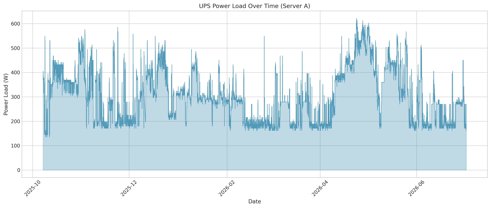](figures_server_a/fig1_time_series.png) |
| **Fig 2** | Hourly Box Plot - Load distribution by hour | [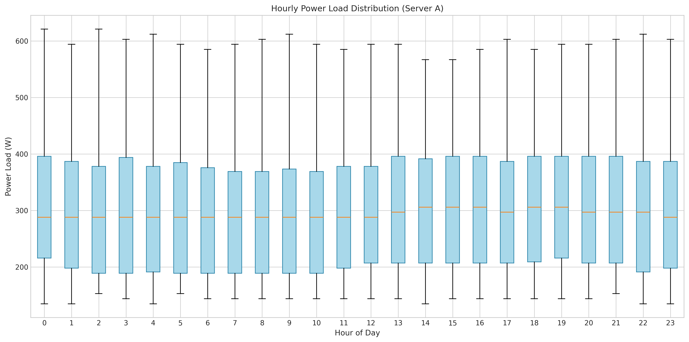](figures_server_a/fig2_hourly_boxplot.png) |
| **Fig 3** | Weekday vs Weekend Comparison | [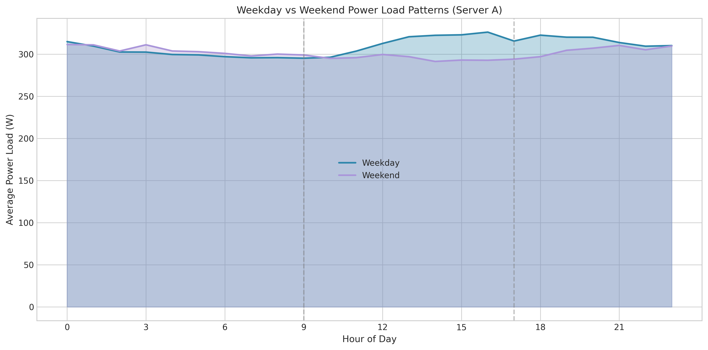](figures_server_a/fig3_weekday_comparison.png) |
| **Fig 4** | Monthly Trend - Load progression | [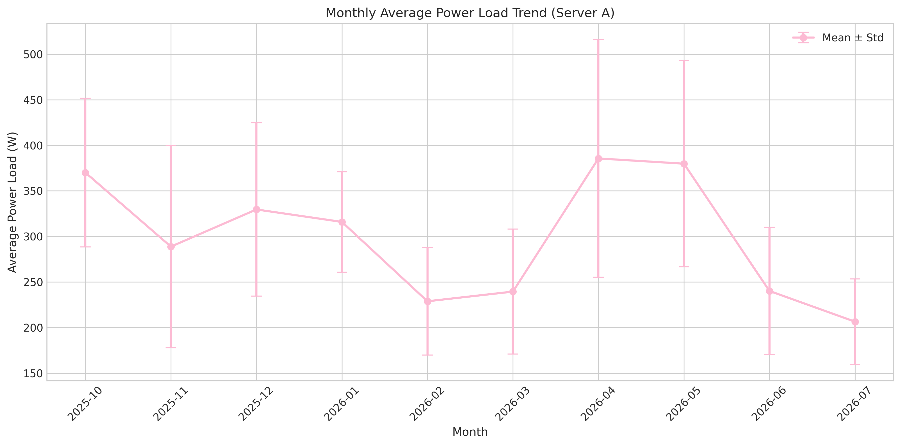](figures_server_a/fig4_monthly_trend.png) |
| **Fig 5** | Load Distribution - Histogram + KDE | [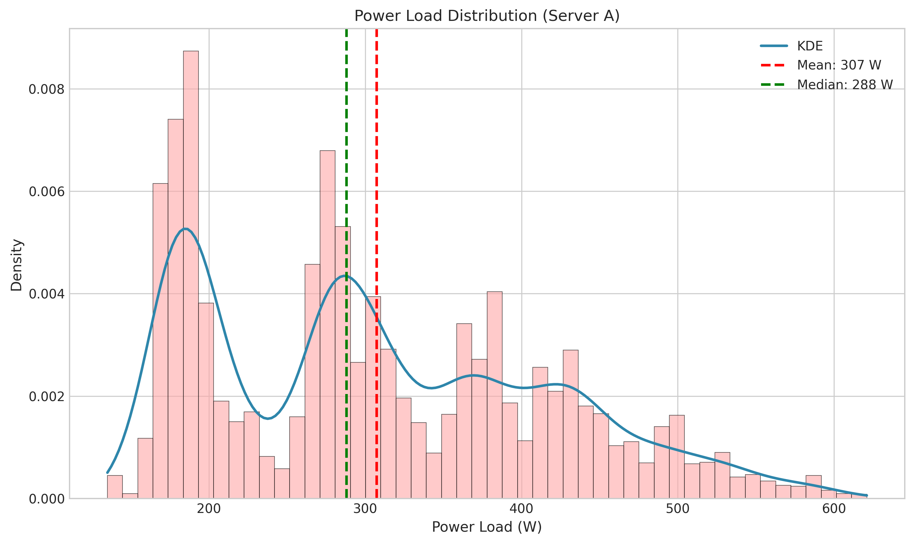](figures_server_a/fig5_load_distribution.png) |
| **Fig 6** | Peak Events - Top 10 peaks highlighted | [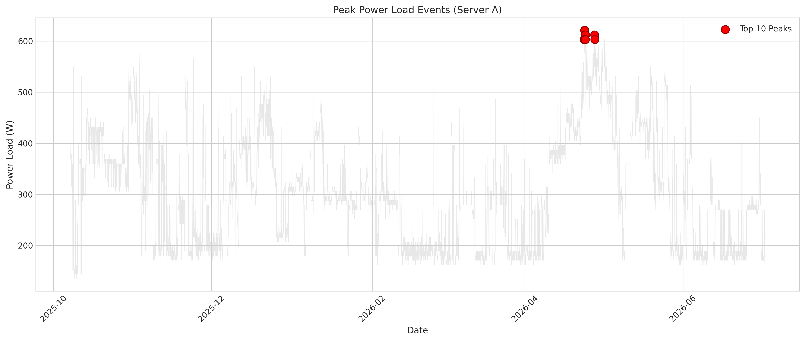](figures_server_a/fig6_peak_events.png) |
| **Fig 7** | Cumulative Energy - Total consumption | [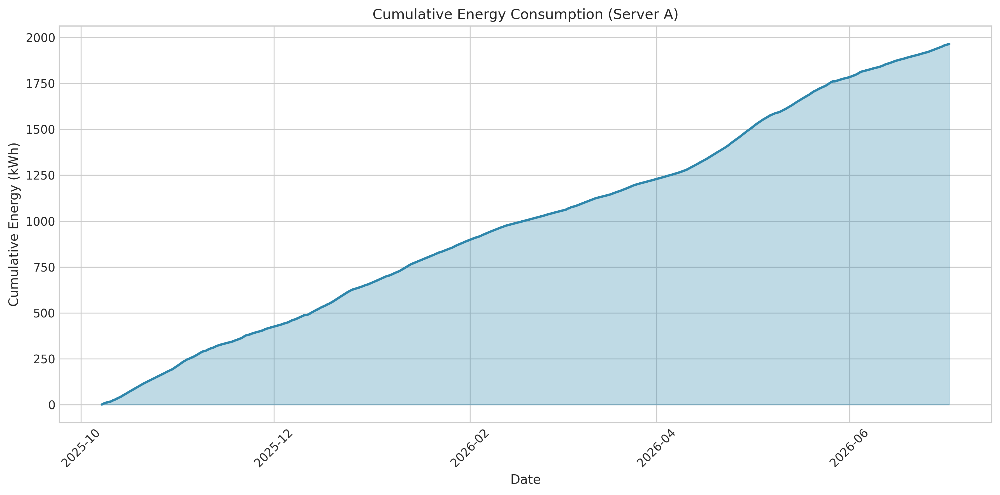](figures_server_a/fig7_cumulative_energy.png) |

---

## 🔍 Server B Analysis

### Executive Summary

| Metric | Value |
|--------|-------|
| **Data Period** | Oct 7, 2025 - Jul 1, 2026 |
| **Total Records** | 6,292 hourly readings |
| **Average Load** | 451.8 W |
| **Peak Load** | 1,035 W |
| **Total Energy** | 2,843 kWh |
| **Average Daily** | 10.7 kWh/day |

### Key Statistics

| Metric | Value |
|--------|-------|
| Median Load | 450 W |
| Standard Deviation | 78.2 W |
| Minimum | 315 W |
| Maximum | 1,035 W |
| Coefficient of Variation | 0.173 |

### Percentile Distribution

| Percentile | Load (W) |
|------------|----------|
| 10th | 369 |
| 25th | 396 |
| 50th (Median) | 450 |
| 75th | 468 |
| 90th | 558 |
| 95th | 630 |
| 99th | 711 |

### Top 5 Peak Load Events

| Rank | Date/Time | Load (W) |
|------|-----------|----------|
| 1 | 2025-11-10 12:00 | 1,035 |
| 2 | 2025-11-18 15:00 | 918 |
| 3 | 2025-11-19 12:00 | 882 |
| 4 | 2026-04-28 07:00 | 864 |
| 5 | 2026-04-27 17:00 | 855 |

### Pattern Analysis

- **Lowest average load:** Hour 5:00 (437.5 W)
- **Highest average load:** Hour 12:00 (465.9 W)
- **Load variation:** 28.4 W across hours
- **Weekday average:** 456.2 W
- **Weekend average:** 441.2 W
- **Weekday/Weekend difference:** 15.0 W

### Anomaly Detection

- **Lower threshold:** 296 W
- **Upper threshold:** 608 W
- **Number of anomalies:** 364
- **Anomaly rate:** 5.79%

### Server B Figures

| Figure | Description | Image |
|--------|-------------|-------|
| **Fig 1** | Time Series - Power load over time | [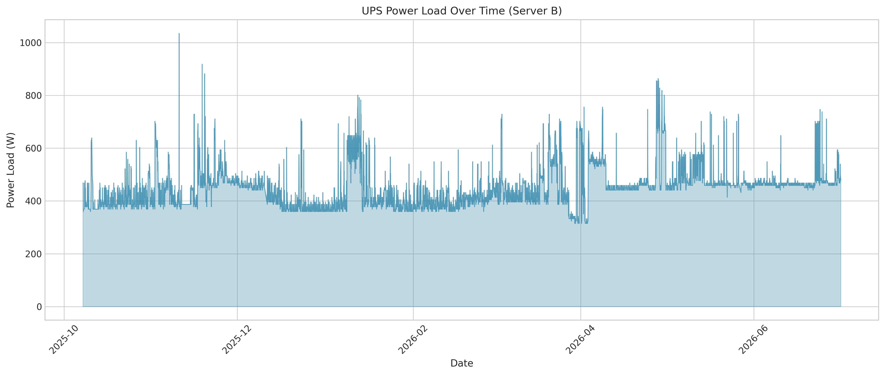](figures_server_b/fig1_time_series.png) |
| **Fig 2** | Hourly Box Plot - Load distribution by hour | [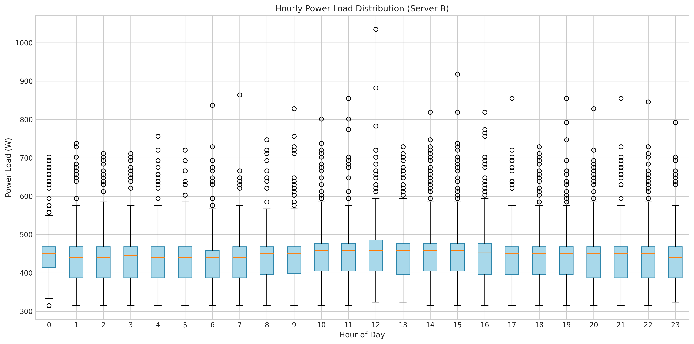](figures_server_b/fig2_hourly_boxplot.png) |
| **Fig 3** | Weekday vs Weekend Comparison | [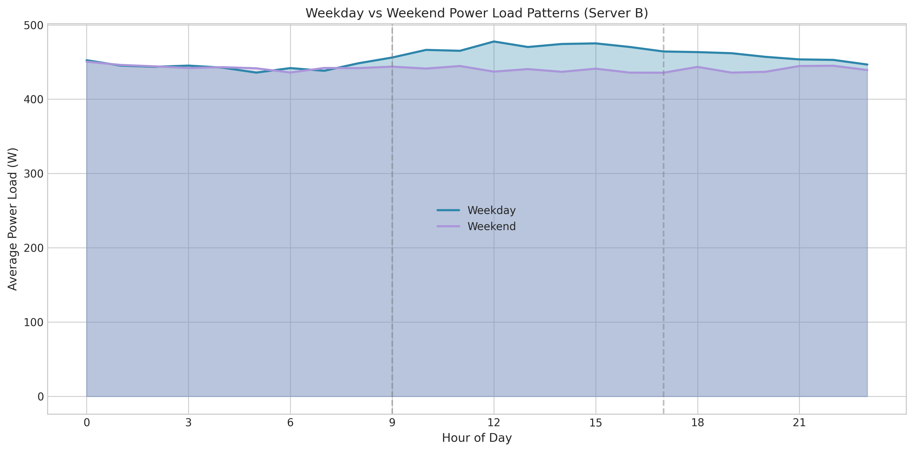](figures_server_b/fig3_weekday_comparison.png) |
| **Fig 4** | Monthly Trend - Load progression | [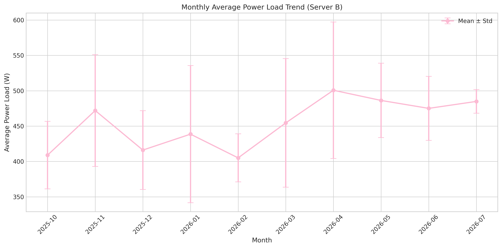](figures_server_b/fig4_monthly_trend.png) |
| **Fig 5** | Load Distribution - Histogram + KDE | [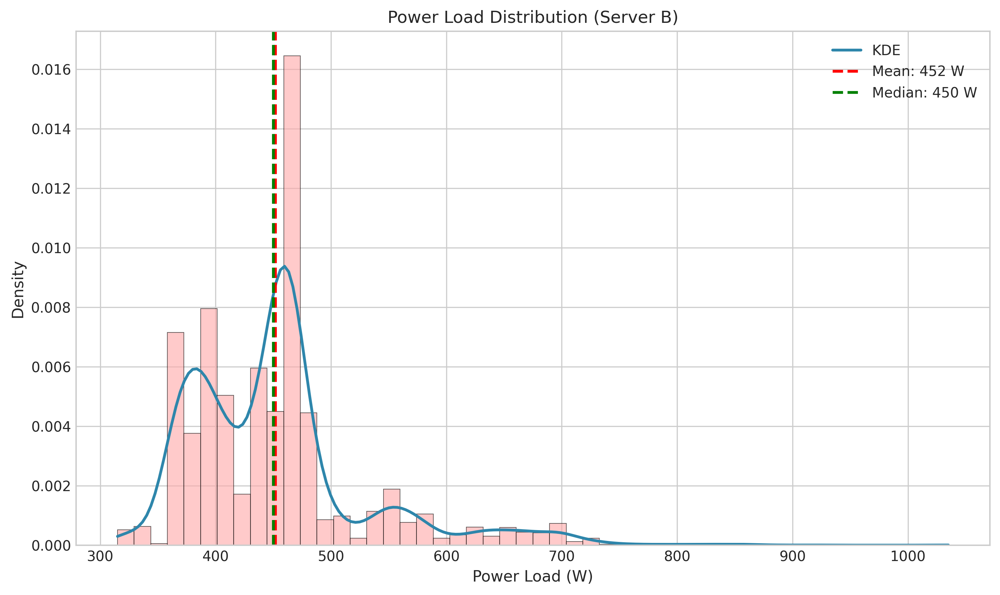](figures_server_b/fig5_load_distribution.png) |
| **Fig 6** | Peak Events - Top 10 peaks highlighted | [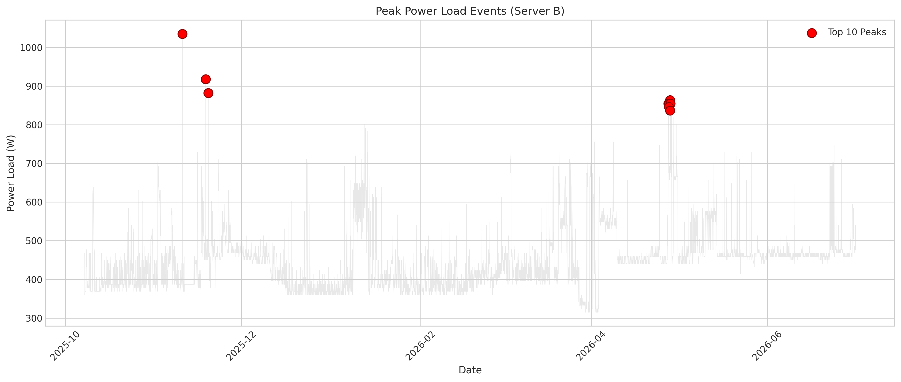](figures_server_b/fig6_peak_events.png) |
| **Fig 7** | Cumulative Energy - Total consumption | [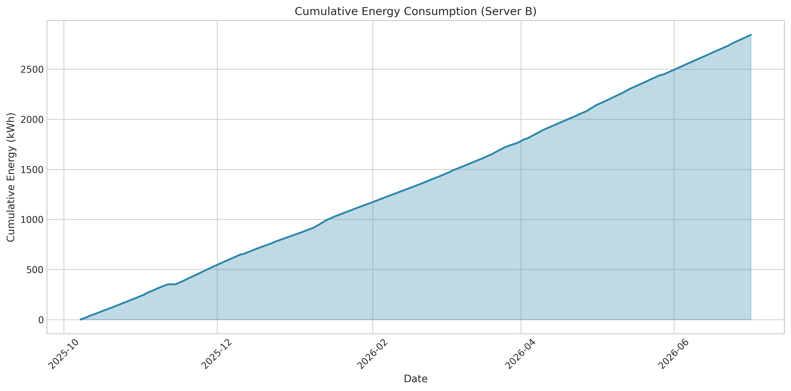](figures_server_b/fig7_cumulative_energy.png) |

---

## 📈 Comparison Report

### Side-by-Side Comparison

| Metric | Server A | Server B | Difference | Winner |
|--------|----------|----------|------------|--------|
| Average Load | 307.3 W | 451.8 W | -144.5 W | 🏆 Server A |
| Peak Load | 621 W | 1,035 W | -414 W | 🏆 Server A |
| Total Energy | 1,965 kWh | 2,843 kWh | -878 kWh | 🏆 Server A |
| Avg Daily | 7.3 kWh | 10.7 kWh | -3.4 kWh | 🏆 Server A |
| Std Dev | 108.2 W | 78.2 W | +30.1 W | 🏆 Server B |
| Coefficient of Variation | 0.352 | 0.173 | +0.179 | 🏆 Server B |

### Percentile Comparison

| Percentile | Server A (W) | Server B (W) | Difference |
|------------|--------------|--------------|------------|
| 10th | 180 | 369 | -189 |
| 25th | 198 | 396 | -198 |
| 50th | 288 | 450 | -162 |
| 75th | 387 | 468 | -81 |
| 90th | 459 | 558 | -99 |
| 95th | 504 | 630 | -126 |
| 99th | 567 | 711 | -144 |

### Hourly Pattern Comparison

| Server | Lowest Hour | Lowest Avg (W) | Highest Hour | Highest Avg (W) |
|--------|-------------|----------------|--------------|-----------------|
| Server A | 10:00 | 296.0 | 16:00 | 316.8 |
| Server B | 5:00 | 437.5 | 12:00 | 465.9 |

### Weekly Pattern Comparison

| Server | Weekday Avg (W) | Weekend Avg (W) | Difference (W) |
|--------|-----------------|-----------------|----------------|
| Server A | 309.6 | 301.5 | 8.1 |
| Server B | 456.2 | 441.2 | 15.0 |

### Monthly Trend Comparison

| Month | Server A Mean (W) | Server B Mean (W) | Difference (W) |
|-------|-------------------|-------------------|----------------|
| 2025-10 | 370.0 | 409.0 | -38.9 |
| 2025-11 | 288.8 | 472.0 | -183.2 |
| 2025-12 | 329.6 | 416.1 | -86.5 |
| 2026-01 | 315.9 | 438.6 | -122.7 |
| 2026-02 | 228.9 | 405.0 | -176.2 |
| 2026-03 | 239.5 | 454.5 | -215.1 |
| 2026-04 | 385.5 | 500.7 | -115.1 |
| 2026-05 | 379.8 | 486.3 | -106.5 |
| 2026-06 | 240.2 | 475.1 | -234.9 |
| 2026-07 | 206.5 | 484.9 | -278.4 |

---

## 📊 Figures & Visualizations

### Server A Visualizations

| # | Figure | Preview |
|---|--------|---------|
| 1 | Time Series | [](figures_server_a/fig1_time_series.png) |
| 2 | Hourly Box Plot | [](figures_server_a/fig2_hourly_boxplot.png) |
| 3 | Weekday Comparison | [](figures_server_a/fig3_weekday_comparison.png) |
| 4 | Monthly Trend | [](figures_server_a/fig4_monthly_trend.png) |
| 5 | Load Distribution | [](figures_server_a/fig5_load_distribution.png) |
| 6 | Peak Events | [](figures_server_a/fig6_peak_events.png) |
| 7 | Cumulative Energy | [](figures_server_a/fig7_cumulative_energy.png) |

### Server B Visualizations

| # | Figure | Preview |
|---|--------|---------|
| 1 | Time Series | [](figures_server_b/fig1_time_series.png) |
| 2 | Hourly Box Plot | [](figures_server_b/fig2_hourly_boxplot.png) |
| 3 | Weekday Comparison | [](figures_server_b/fig3_weekday_comparison.png) |
| 4 | Monthly Trend | [](figures_server_b/fig4_monthly_trend.png) |
| 5 | Load Distribution | [](figures_server_b/fig5_load_distribution.png) |
| 6 | Peak Events | [](figures_server_b/fig6_peak_events.png) |
| 7 | Cumulative Energy | [](figures_server_b/fig7_cumulative_energy.png) |

---

## 📅 Historical Data

### Monthly Energy Breakdown

| Month | Server A (kWh) | Server B (kWh) | Total (kWh) |
|-------|----------------|----------------|-------------|
| 2025-10 | 225 | 239 | 464 |
| 2025-11 | 176 | 306 | 482 |
| 2025-12 | 201 | 302 | 503 |
| 2026-01 | 233 | 325 | 558 |
| 2026-02 | 132 | 272 | 404 |
| 2026-03 | 146 | 337 | 483 |
| 2026-04 | 219 | 359 | 578 |
| 2026-05 | 231 | 353 | 584 |
| 2026-06 | 145 | 342 | 487 |
| 2026-07 | 17 | 8 | 25 |

---

## 🛠️ Analysis Script

The analysis was performed using a Python script that:

1. **Loads and cleans** the power log data
2. **Computes descriptive statistics** (mean, median, std, percentiles)
3. **Identifies peak events** and anomalies
4. **Analyzes temporal patterns** (hourly, daily, monthly)
5. **Generates visualizations** (7 figures per server)
6. **Creates comprehensive reports** (Markdown format)

**Script Location:** [`analysis_script.py`](analysis_script.py)

### Running the Analysis

```bash
# Install dependencies
pip install pandas numpy matplotlib scipy

# Run the analysis
python analysis_script.py
```

---

## 📋 Data Quality

| Server | Data Completeness | Missing Hours | Total Records |
|--------|-------------------|---------------|---------------|
| Server A | 98.2% | 117 | 6,393 |
| Server B | 98.2% | 117 | 6,292 |

---

## 🔧 Recommendations

### Based on the Analysis

1. **Peak Load Management**
   - Server B has significantly higher peaks (1,035 W vs 621 W)
   - Consider load balancing to reduce peak demand charges

2. **Capacity Planning**
   - Size UPS systems based on the higher peak load (1,035 W)
   - Recommended headroom: 20-30% (1,300-1,500 W)

3. **Weekend Optimization**
   - Both servers show lower weekend loads
   - Consider power-saving modes during low-usage periods

4. **Anomaly Monitoring**
   - Server A: 212 anomalies (3.32%)
   - Server B: 364 anomalies (5.79%)
   - Investigate anomalous readings for equipment issues

5. **Load Balancing**
   - Server A is more energy-efficient
   - Consider redistributing workloads to optimize overall consumption

---

## 📞 Contact & Support

For questions about this analysis or to request new analysis runs, please open an issue in the repository.

---

*Report generated automatically by UPS Power Analysis Script*  
*Last updated: July 2, 2026*
